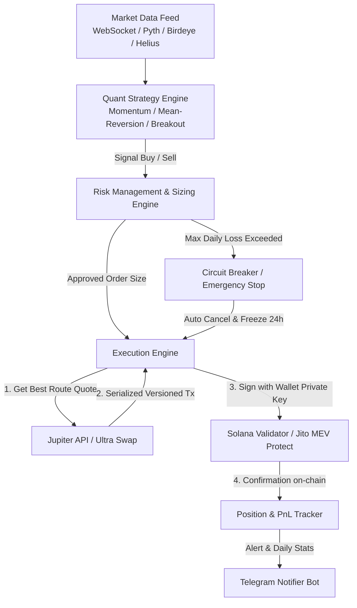

# Product Requirement Document (PRD)
# LVQuant Trading Bot — Solana & Jupiter DEX Aggregator

---

## 1. Ringkasan Eksekutif & Objektif

Dokumen ini mendefinisikan arsitektur teknis dan kebutuhan fungsional untuk **LVQuant Trading Bot**, yaitu sistem trading kuantitatif (*algorithmic / quant trading*) otomatis yang beroperasi di ekosistem **Solana** menggunakan agregator DEX nomor satu, **Jupiter Protocol**.

Tujuan utama sistem ini:
- Menjalankan eksekusi trading otomatis tanpa bias emosi.
- Memanfaatkan latensi sangat rendah di Solana (<400ms) dan routing likuiditas terbaik dari Jupiter.
- Mengedepankan **Capital Preservation** (perlindungan modal riil) melalui manajemen risiko berlapis (*stop-loss*, *trailing-stop*, dan *circuit breaker* harian).

---

## 2. Spesifikasi Ekosistem & Platform

| Aspek | Pilihan / Nilai | Penjelasan |
| :--- | :--- | :--- |
| **Network** | Solana Mainnet-Beta | Biaya transaksi sangat murah (~$0.001 - $0.005) & eksekusi instan |
| **DEX Layer** | Jupiter Swap API (`api.jup.ag`) | Agregator seluruh DEX Solana (Raydium, Orca, Meteora, dll.) |
| **Model Wallet** | Self-Custodial (Non-Custodial) | Dana tetap di wallet pribadi, bot hanya menandatangani (*sign*) via private key lokal |
| **Wallet Kompatibel** | Phantom / Solflare / Backpack | Private key format Base58 diekspor ke `.env` lokal |
| **Aset Utama** | SOL, USDC, atau Token Likuid | Pair dapat disesuaikan (cth: SOL/USDC atau token momentum/SOL) |
| **Node RPC** | Helius / Quicknode / Triton | Wajib RPC performa tinggi dengan fitur Priority Fee & DAS API |
| **Frontend Stack** | Next.js (App Router) + Tailwind CSS | Integrasi langsung dengan komponen SSYCH Vault |
| **Design System** | SSYCH Components Vault | Wajib 100% patuh pada SSYCH_COMPONENTS_VAULT.md (no gimmick/no generic AI style) |

---

## 3. Aturan Ketat Integritas Data & UI (Strict Constraints)

1. **100% Real Data & Execution (Zero Dummy / Zero Gimmick)**:
   - Dilarang keras menggunakan data acak/dummy/mock PnL palsu.
   - Semua angka di UI (harga, balance, PnL, transaksi) harus bersumber langsung dari on-chain Solana via RPC atau API resmi (Jupiter/Helius/Birdeye). Jika data belum tersedia, tampilkan indikator loading / disconnected, bukan angka palsu.
2. **Kepatuhan UI WAJIB FULL 100% terhadap SSYCH Components Vault & Anti-AI Slop**:
   - **Komponen UI Wajib 100% dari Vault**: Seluruh elemen visual dashboard (chart, scrubber, segmented controls, live figure, switchers, buttons, inputs/fields, table, index card, market snapshot) **WAJIB FULL** diambil langsung dari file [SSYCH_COMPONENTS_VAULT.md](file:///Volumes/LVNPC/ALL%20PROJECT/LVQUANT/SSYCH_COMPONENTS_VAULT.md).
   - **Dilarang memakai UI library lain**: Dilarang menginstall Shadcn eksternal sembarangan, Chakra, MUI, AntD, dll. Murni gunakan source code komponen dari vault.
   - **Dilarang keras AI Slop**: Jangan menambahkan badge-badge hiasan yang tidak perlu (seperti "AI Powered", "Smart Algo", chip/tag dekoratif tak bermakna).
   - **Dilarang animasi berlebihan**: Jangan menambahkan dot blinking/pulsing tanpa fungsi, glow murahan, shimmer looping, atau efek grafis yang tidak ada di vault. Animasi hanya diizinkan jika memang fungsional bawaan vault (seperti transisi angka `LiveFigure` atau pergeseran scrubber).
   - Penyesuaian di luar vault hanya sebatas penataan layout container, padding, size, margin, atau modal fungsional pendukung dengan token styling asli dari `control-classes.ts` (`THUMB`, `TRACK`, `BUTTON`, `FIELD`, `ICON_BUTTON`).
3. **No Over-Improvement & No Silent Fallbacks**:
   - Logika quant dan eksekusi harus deterministik. Jika terjadi error API, hentikan eksekusi dan catat error secara transparan. Dilarang membuat fallback diam-diam yang memalsukan keberhasilan transaksi.
   - Jika ada logika, formula, atau aturan risiko yang ambigu, **wajib bertanya dan konfirmasi ke user**.

---

## 4. Diagram Alur Sistem (Architecture Flow)

---

## 4. Modul Fungsional Utama

### 4.1. Manajemen Wallet & Keamanan (Security First)
- **Dedicated Sub-Wallet**: Jangan gunakan wallet utama tempat menyimpan tabungan aset besar. Gunakan wallet baru khusus bot dengan saldo operasional terbatas.
- **Enkripsi Kunci Privat**: Private key hanya dibaca dari environment variable lokal (`.env`), tidak pernah dicatat di log atau commit ke git.
- **Auto Clean WSOL / ATA**: Otomatis menutup token account kosong (*close account*) untuk me-reclaim deposit rent SOL kembali ke dompet.

### 4.2. Strategy Engine (Modular)
Sistem mendukung penggantian strategi secara dinamis:
1. **Trend Following / Momentum**:
   - Deteksi lonjakan volume mendadak + pergerakan indikator (EMA Cross / RSI Breakout).
2. **Mean-Reversion / Grid Trading**:
   - Membeli di titik oversold dan menjual saat kembali ke rata-rata harga untuk pair stabil seperti SOL/USDC.
3. **On-chain Signal / Breakout**:
   - Eksekusi berdasarkan metrik likuiditas dan volume DEX terbaru.

### 4.3. Risk Management & Proteksi Modal (Paling Krusial untuk Uang Riil)
- **Position Sizing Dinamis**:
  - Batasi risiko per transaksi: maksimal 2% - 5% dari total saldo per posisi.
- **Hard Stop-Loss (SL)**:
  - Jual otomatis jika posisi rugi menyentuh threshold (misal: -3% atau -5%).
- **Trailing Stop-Loss**:
  - Mengunci keuntungan saat harga naik (misal jika sudah untung +10%, trailing stop aktif 3% di bawah harga puncak).
- **Daily Drawdown Circuit Breaker**:
  - Jika akumulasi rugi harian menyentuh batas aman (misal -7% total modal), bot **otomatis berhenti trading selama 24 jam** dan memberi peringatan darurat.
- **Token Security Filter** (Jika mentradingkan koin baru/hype):
  - Cek otomatis via RugCheck API: pastikan mint authority disabled, freeze authority disabled, dan likuiditas terkunci.

### 4.4. Execution Engine & MEV Protection
- **Dynamic Slippage**: Menyesuaikan toleransi slippage secara otomatis berdasarkan volatilitas spread (0.5% - 2.0%).
- **Priority Fees (Compute Budget)**: Menambahkan tip gas mikro secara dinamis agar transaksi diprioritaskan oleh validator saat jaringan padat.
- **Jito MEV Protection**: Opsi rute bundle melalui Jito Block Engine agar transaksi aman dari serangan *sandwich bot*.

### 4.5. Monitoring & Notifikasi Real-Time
- **Telegram Bot Integration**:
  - Notifikasi instan setiap kali bot melakukan aksi: *Buy/Sell, Harga, Ukuran, Link Solscan*.
  - Laporan harian: *Realized PnL, Win-Rate, Total Equity*.
  - Remote command darurat langsung dari chat Telegram:
    - `/status` : Cek posisi & saldo saat ini.
    - `/pause` : Jeda trading baru.
    - `/resume` : Lanjutkan bot.
    - `/panic_sell` : Tutup semua posisi aktif menjadi USDC/SOL.

---

## 5. Non-Functional Requirements (NFR)
- **Latensi**: Response rate quote ke sign < 1 detik.
- **Error Handling**: Graceful fallback jika RPC timeout, rate limit, atau terjadi network drop.
- **Logging**: Logging terstruktur per menit ke file JSONL untuk bahan evaluasi backtesting & audit performa.

---

## 6. Rencana Tahapan Eksekusi (Roadmap)

| Fase | Target | Output |
| :--- | :--- | :--- |
| **Fase 1: Setup & Engine Inti** | Hari 1–2 | Koneksi RPC, integrasi Jupiter SDK, cek balance wallet, test swap bernilai kecil (~$1) |
| **Fase 2: Risk Management Layer** | Hari 3–4 | Modul SL/TP, Trailing Stop, kalkulator sizing, dan Circuit Breaker harian |
| **Fase 3: Strategy & Feed Data** | Hari 5–6 | Integrasi data harga real-time, implementasi logika sinyal strategi |
| **Fase 4: Paper Trading (Simulasi)** | 3–5 Hari | Menjalankan bot di live data tanpa uang riil untuk validasi logika |
| **Fase 5: Live Execution Skala Mikro** | Seterusnya | Menjalankan dengan modal kecil (0.2 - 0.5 SOL), evaluasi slippage & performa harian |

---

## 7. Poin Diskusi & Penyesuaian

Silakan kita bahas aspek-aspek berikut:
1. **Target pair/koin apa yang ingin difokuskan di awal?** (Cth: pair likuid besar seperti SOL/USDC, atau koin volatilitas tinggi/meme?)
2. **Gaya trading apa yang paling Anda sukai?** (Scalping menit, Swing beberapa jam, DCA akumulasi, atau Momentum volume breakout?)
3. **Preferensi bahasa**: Apakah ingin menggunakan **TypeScript/Node.js** atau **Python**?
